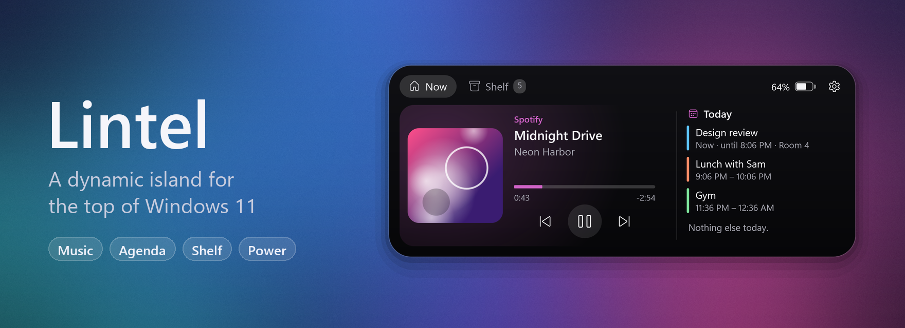
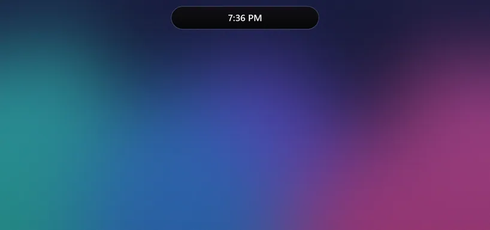
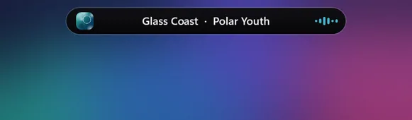
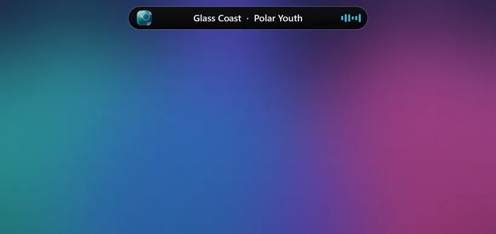

<p align="center">
  
</p>

# Lintel

A dynamic island for the top of your Windows 11 screen. It rests as a small pill, shows what's playing, flashes
volume, brightness and power changes, keeps today's agenda one hover away, and holds files you drop on it.

## See it in action

**Something starts playing.** The island announces the track, then the pill shows the cover, the title and a live
visualizer. Open it for controls, seeking and today's agenda.

<p align="center"></p>

**Plugging in and unplugging.** A short notice shows the charge, and how long until full or how long it will last.

<p align="center"></p>

**Volume.** Changes show up as a level meter, so you can keep your eyes where they were.

<p align="center"></p>

**Shelf.** Drop files, images, text or links on the island to park them, then drag them out wherever you need them.

<p align="center"></p>

<sub>The demos are recorded by the app itself (`Lintel.exe --demo <folder>`) with a made-up track, generated cover
art and simulated power events, then composed with `tools/make_media.py`.</sub>

## Features

- **Now playing**: album art, title, a live audio visualizer, and controls for any app in the Windows media
  controls (Spotify, browsers, Media Player, VLC…). Click the progress bar to seek.
- **Peeks**: short notices under the pill for track changes, volume, brightness, plugging in or unplugging,
  low battery, energy saver and finished downloads.
- **Today**: your agenda from any iCalendar (.ics) link: Google Calendar, Outlook or iCloud.
- **Shelf**: drop files, images, text or links on the island, then drag them out anywhere, or share them with the
  Windows share sheet.
- **Downloads**: shows when a browser download is in progress, and can put finished downloads on the shelf.
- **OLED care**: optional hide-when-idle, and a slow pixel shift so the island never burns in.
- **Multi-monitor**: main display, a specific display, every display, or whichever one your pointer is on.
- **Keeps out of the way**: hides in fullscreen apps, can stay out of screenshots and recordings, and scrolling over
  it changes the volume.

### When an app is under the island

Windows has no reserved strip at the top like the macOS menu bar, so browser tabs, title bars and search boxes can sit
right where the island is. You choose what happens (Settings → Island):

| Option | What it does |
|---|---|
| **Slim down** (default) | Over a maximized app, the pill shrinks to a thin bar that clicks pass through, so tabs and search boxes keep working. Rest the pointer at the very top edge to open it. |
| **Reserve space at the top** | Keeps a 24 px strip free, like a top taskbar, so maximized apps start below the island. |
| **Stay on top as usual** | The pill always floats over whatever is underneath. |

Open it by resting the pointer on it, clicking it, or pressing **Ctrl+Alt+L** (you can change this in Settings).
Right-click the tray icon for Settings and Quit.

## Lightweight

At rest Lintel uses under **1% of one CPU core and ~40 MB of RAM**, and its transitions run at your display's
refresh rate (120 fps on a 120 Hz screen). The window shrinks to hug the pill when nothing is animating, the mouse
is polled slowly when it's far away, hidden layers don't render, shadows are plain fills instead of blur effects,
and audio capture for the visualizer only runs while something is playing.

If transitions look wrong on your GPU, set the environment variable `LINTEL_SOFTWARE=1` to use software rendering
(capped at ~60 fps). `LINTEL_PERF=1` logs frame timing for each transition to `%APPDATA%\Lintel\lintel.log`.

## Requirements

- Windows 11 (Windows 10 2004+ should also work)
- [.NET 8 Desktop Runtime](https://dotnet.microsoft.com/download/dotnet/8.0) to run; .NET 8 SDK to build

## Build

```bash
dotnet build src/Lintel/Lintel.csproj -c Release
```

The app is written to `src/Lintel/bin/Release/net8.0-windows10.0.22621.0/Lintel.exe`.

To get a self-contained single file that needs no installed runtime:

```bash
dotnet publish src/Lintel/Lintel.csproj -c Release -r win-x64 --self-contained -p:PublishSingleFile=true -o publish
```

To regenerate the README media after UI changes (needs Python with Pillow):

```bash
src/Lintel/bin/Release/net8.0-windows10.0.22621.0/Lintel.exe --demo demo-frames
```

```bash
python tools/make_media.py demo-frames docs/media
```

## Privacy

Lintel doesn't collect anything. The only network requests it makes are to the calendar links you add.
Settings, the shelf list and a small log live in `%APPDATA%\Lintel`.

## Background

Lintel is inspired by the idea behind [Boring Notch](https://github.com/TheBoredTeam/boring.notch) for macOS.
It's an independent, clean-room Windows implementation: no code, assets or text were taken from that project.
See [docs/CLEAN_ROOM.md](docs/CLEAN_ROOM.md) and [docs/FINDINGS.md](docs/FINDINGS.md). Lintel isn't affiliated with
or endorsed by the Boring Notch authors.

## License

[MIT](LICENSE)
